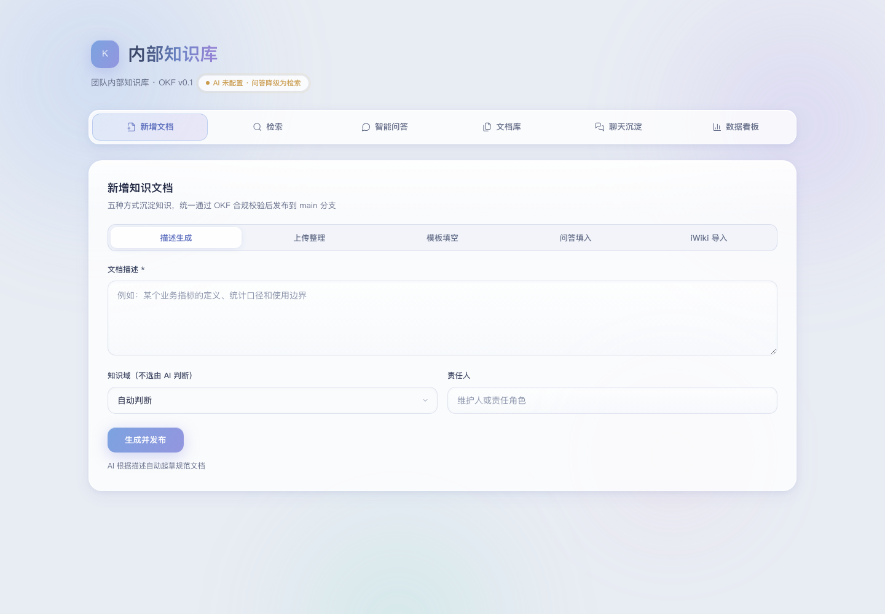

# 内部知识库

这是一个可复用的通用内部知识库：用 Markdown 保存知识，用管理台完成检索、问答、整理、审核与发布。

## 管理台预览



管理台提供新增文档、混合检索、智能问答、文档审核、聊天沉淀和知识健康度看板。前端采用 React、TypeScript 与 Vite，后端使用 Node.js 原生 HTTP 服务，保留本地部署和离线降级能力。

## 知识分类

| 目录 | 内容 | 默认 type |
|---|---|---|
| `metrics/` | 指标、术语、度量口径和基线 | `Metric` |
| `product/` | 系统、功能、工具和接口说明 | `Feature` |
| `team/` | 协作约定、术语、资源和决策 | `Context` |
| `guides/` | 操作流程、问题排查、报告和纪要 | `Guide` |
| `references/` | 公开资料、调研笔记和外部参考 | `Reference` |
| `templates/` | 可复用文档模板 | `Template` |

## 核心能力

- 文档新增、在线编辑、删除、状态流转与模板填空；
- 关键词、向量和重排组成的混合检索；
- 基于资料引用的多轮智能问答；
- Markdown、TXT、Word、PDF 的上传整理；
- 图片上传、文档索引、质量校验和知识治理；
- 可选的 MCP 文档导入及聊天归档沉淀，均通过环境变量配置。

## 技术架构

| 层次 | 技术实现 |
|---|---|
| 前端 | React 19、TypeScript、Vite、React Router |
| 服务端状态 | TanStack Query |
| 表单与校验 | React Hook Form、Zod |
| 文档渲染 | React Markdown、remark-gfm |
| 后端 | Node.js ESM、原生 HTTP API、SSE |
| Agent | 自研 ReAct 风格工具循环，不依赖 LangChain/LangGraph |
| RAG | 关键词与向量双路召回、RRF 融合、重排与关键词降级 |
| 测试 | Vitest、Playwright |

## 本地运行

```bash
git clone https://github.com/xiaosutongzhi/Knowledge_agent.git
cd Knowledge_agent
cp .env.example .env

cd agent
npm install
cd frontend
npm install
npm run build
cd ../..

node agent/serve.mjs
```

浏览器访问 `http://localhost:8080`。未配置 LLM 时，智能问答会自动降级为知识库检索，不影响文档维护和检索功能。

## 使用原则

1. 只收录已获授权的公开资料或本组织允许共享的内容。
2. 文档必须标明来源；不确定内容使用 `review` 或 `verify` 状态。
3. 不要将密钥、账号、个人信息、客户数据或内部链接写入仓库。

更多格式要求见 [填写规范](CONTRIBUTING.md)，部署与管理台说明见 [Agent 使用说明](agent/README.md)。
